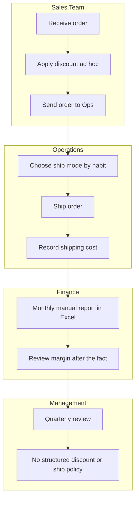
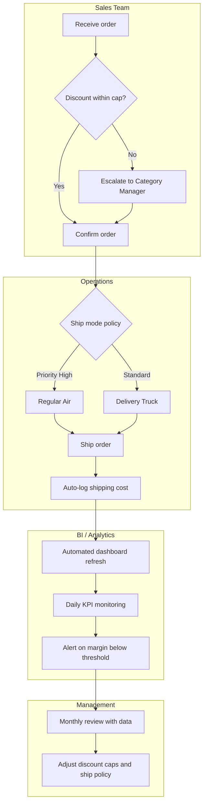

# Process Maps — Retail Sales Performance & Profitability Analysis

## AS-IS Process (current state)

## TO-BE Process (target state)

## Gap Analysis

| # | Gap | AS-IS | TO-BE | Action |
|---|---|---|---|---|
| 1 | Discount governance | Ad hoc discounts | Discount cap per category | Define caps from discount analysis |
| 2 | Ship-mode selection | Habit-based | Policy by order priority | Publish ship-mode matrix |
| 3 | Reporting cadence | Monthly manual Excel | Daily automated dashboard | Deploy dashboard |
| 4 | Margin monitoring | After the fact | Real-time alerts | Set margin threshold alerts |
| 5 | Loss-making SKUs | Not tracked | Flagged in dashboard | Quarterly SKU review |
| 6 | Stakeholder alignment | Quarterly only | Monthly data review | Add monthly review to calendar |
